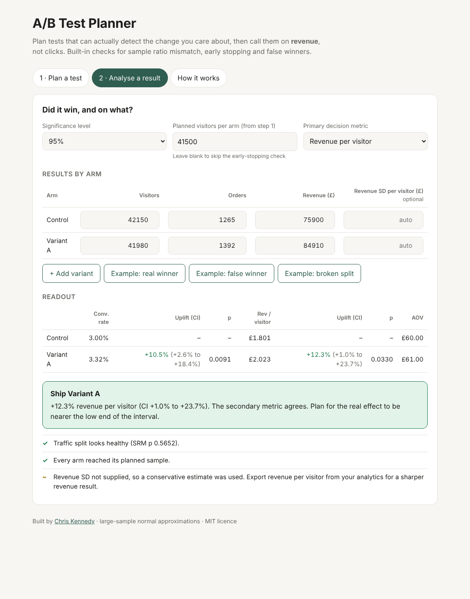

# A/B Test Planner

**Plan A/B tests that can detect the change you care about, then call them on revenue, not clicks.**

🔗 **Live demo:** https://cdkennedy247.github.io/ab-test-planner/

A single-page tool I built from 14 years of running experimentation programmes for consumer and subscription brands. It covers the mistakes I've seen most often: tests too small to detect anything, tests stopped the first time they look significant, broken traffic splits, and "winners" that raise conversion while losing money.

## What it does

**1. Plan a test**
- Sample size per arm from baseline conversion, minimum detectable uplift, significance and power
- Run time rounded up to whole weeks, so weekday and weekend behaviour are equally represented
- Multi-variant tests corrected for multiple comparisons (Bonferroni)
- What the uplift is worth per quarter, if it's real

**2. Analyse a result**
- Conversion rate (two-proportion z-test) and revenue per visitor (Welch z-test), each with relative uplift and confidence interval
- Choose the primary decision metric up front; revenue per visitor by default
- A plain-English verdict: ship, don't ship, inconclusive, or don't trust the test

**3. Guardrails that catch false winners**
- **Sample ratio mismatch:** chi-square check that the traffic split matches what was intended
- **Early stopping:** won't call a winner before every arm reaches its planned sample
- **Metric conflict:** flags when conversion and revenue move in different directions, such as more orders at a lower order value

Try the built-in examples: a real winner, a false winner (conversion +10%, revenue −2.6%) and a broken traffic split.

## Why revenue, not conversion

In one programme I ran, opening a hotel page's rooms tab by default lifted engagement but cut conversion by 2.04%. Judged on engagement it looked like a win. Judged on revenue it would have cost £166k a quarter, so it was never shipped. This tool makes that check the default.

## Method notes

- Large-sample normal approximations throughout, appropriate for typical web-scale test volumes
- If revenue standard deviation per visitor isn't supplied, a conservative estimate is used; supply it from your analytics for sharper revenue results
- Everything runs in the browser. No data leaves the page.

## Run it

No build step. Open `index.html` in a browser, or serve it with GitHub Pages.

## Built with

Plain HTML, CSS and JavaScript, developed with Claude Code.

---

Chris Kennedy · [LinkedIn](https://linkedin.com/in/cdkennedy) · MIT licence
